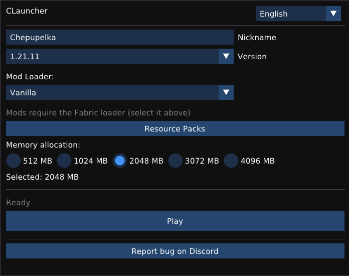
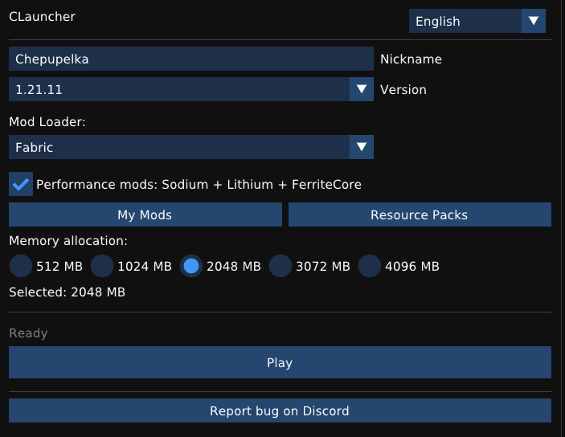

🇬🇧 English | 🇷🇺 [Русский](README_RU.md) | 🇰🇿 [Қазақша](README_KZ.md)

# CLauncher

A lightweight native Minecraft launcher for Linux and Windows, written in C++20 with a Dear ImGui interface and OpenGL. Designed and built by a single developer for older hardware: no ads, no telemetry, no store, no account required for offline play.

<p align="center">
  
</p>

Requires **OpenGL 3.3 Core** or newer. Runs on Linux (Debian, Ubuntu, Mint, Kali, Fedora, Arch, openSUSE, Alpine and other distributions) and Windows 10/11. The binary is about three megabytes, and the launcher itself idles at roughly 30 to 50 MB of RAM (Minecraft's own memory is configured separately in the UI). The reference development machine is a 2012 desktop computer, used as a practical old-hardware baseline rather than a guarantee for every possible system configuration.

## Features

* **Vanilla Minecraft installation** straight from the launcher: client, libraries, assets and native libraries are downloaded automatically from the official Mojang servers.
* **Fabric support (Minecraft 1.14+).** Fabric is installed through the official Fabric installer, and the loader version is fetched live from Fabric Meta. For older versions the Fabric option is hidden.
* **Performance mods** with one checkbox: Fabric API, Sodium, Lithium and FerriteCore. Mod versions are matched automatically to the selected Minecraft version through the Modrinth API.
* **Log4Shell Protection.** Automatically applies the `-Dlog4j2.formatMsgNoLookups=true` JVM argument for Minecraft versions below 1.18.1, protecting you from the critical RCE vulnerability (CVE-2021-44228).
* **Smart Downloads.** An adaptive thread pool analyzes the number of files and CPU cores to download assets up to 3–4 times faster. Speed and ETA calculations are accurate and highly responsive.
* **Cancel Installation.** You can safely close the launcher window during a download, and the background installation process will abort correctly without launching the game.

<p align="center">
  
</p>

* **Your own mods.** The My Mods button opens the mods folder for the selected Fabric version. Any jar file you drop there is loaded at game startup. Each Minecraft version has its own mods folder, so mods from different versions never get mixed together.
* **Resource packs.** The Resource Packs button opens the shared resource pack folder. Drop a zip pack there, then enable it in Minecraft's in-game resource pack menu.
* **Automatic Java management.** The launcher automatically downloads and manages portable JREs (8, 17, 21) from Adoptium directly into its own directory. System Java and package managers (apt, dnf, pacman) are no longer required. No `sudo` needed.
* **Integrity checking.** Downloaded game files — the client, libraries, native libraries and assets — as well as performance mods from Modrinth are verified by SHA1 (via OpenSSL) whenever Mojang or Modrinth provide a checksum. Corrupted and incomplete files are detected and re-fetched automatically.
* **Single-instance protection.** Accidentally launching CLauncher twice no longer opens a second window — the duplicate process exits immediately, so two copies never download assets into the same folder at the same time.
* **Session persistence.** Your nickname, selected Minecraft version, mod loader, memory allocation and language are saved between launches.
* **Clean window handling.** When you press Play, the launcher window hides itself while the game is running and reappears automatically when you exit Minecraft.
* **Responsive interface.** All installation work runs in a background thread, the window never freezes, and progress is shown in real time. You can even switch languages on the fly.
* **Two interface languages.** English and Russian, switchable on the fly, with the choice saved.
* **File logging.** All launcher output is written to `clauncher.log` in the `~/.clauncher/logs/` directory (or `%APPDATA%\CLauncher\logs\` on Windows), which makes debugging on both platforms easy.
* **Safe game launch.** The game starts through `execv` on Linux and `CreateProcessW` on Windows, with no shell involved. A long classpath is passed through an argfile, so neither its length nor special characters in the nickname can break the launch.

## Supported Versions

* **Vanilla and Fabric:** every 1.x release in the Mojang manifest, through the 1.21.x line (Fabric from 1.14.x onward).
* **The 26.x line** is temporarily not supported in 1.0.2. It requires Java 25 and a new modding toolchain, which are still stabilizing. **Support for 26.x is planned for version 1.0.4 (see the [Roadmap](#roadmap)).**

**System requirements:** any modern Linux distribution with glibc 2.35+ and **OpenGL 3.3 Core**, or Windows 10 and 11. The prebuilt AppImage needs glibc 2.35 or newer; on older systems build from source.

## Download

Ready-to-use builds are available on the [Releases page](https://github.com/chepupel123/CLauncher/releases):

* `CLauncher-Linux.zip` — Linux x86_64. Contains the self-contained `CLauncher-x86_64.AppImage`: everything is bundled, no extra packages needed (requires glibc 2.35+; unzip, make executable, run).
* `CLauncher-Windows-x64.zip` — Windows 10/11 x64 (beta, not yet fully tested on a physical Windows system). Contains `CLauncher.exe` together with the required GLFW/curl/OpenSSL DLLs and `cacert.pem`; unzip and run the exe.

If you prefer to build from source, follow the steps below.

## Quick Start on Linux

First, install the dependencies. In a terminal run:

**Debian / Ubuntu / Mint / Kali / Pop!_OS:**
```bash
sudo apt-get update
sudo apt-get install -y build-essential cmake git pkg-config unzip \
  libglfw3-dev libgl1-mesa-dev libcurl4-openssl-dev libssl-dev \
  nlohmann-json3-dev libx11-dev libxrandr-dev libxinerama-dev \
  libxcursor-dev fonts-dejavu-core

**Fedora / RHEL / CentOS Stream:**
```bash
sudo dnf install -y gcc-c++ cmake git pkg-config unzip \
  glfw-devel mesa-libGL-devel libcurl-devel openssl-devel \
  nlohmann-json-devel libX11-devel libXrandr-devel \
  libXinerama-devel libXcursor-devel dejavu-sans-fonts
```

**Arch / Manjaro / EndeavourOS:**
```bash
sudo pacman -S --needed base-devel cmake git pkg-config unzip \
  glfw mesa curl openssl nlohmann-json libx11 libxrandr \
  libxinerama libxcursor ttf-dejavu
```

Then get the project and build it:

```bash
git clone https://github.com/chepupel123/CLauncher.git
cd CLauncher
rm -rf build
mkdir build
cd build
cmake ..
make -j$(nproc)
```

Run it:

```bash
./CLauncher
```

## Quick Start on Windows

You will need **MSYS2**. Download the installer from msys2.org and install it to `C:\msys64`. Open the **MSYS2 UCRT64** terminal and run:

```bash
pacman -Syu
pacman -S --needed mingw-w64-ucrt-x86_64-gcc mingw-w64-ucrt-x86_64-cmake \
  mingw-w64-ucrt-x86_64-ninja mingw-w64-ucrt-x86_64-curl \
  mingw-w64-ucrt-x86_64-openssl mingw-w64-ucrt-x86_64-glfw \
  mingw-w64-ucrt-x86_64-nlohmann-json make
```

Then navigate to the project folder and build:

```bash
mkdir build
cd build
cmake .. -G Ninja -DCMAKE_BUILD_TYPE=Release
ninja
```

This produces `CLauncher.exe`. The release zip bundles all required DLLs and a `cacert.pem` TLS trust store.

## How It Works Under the Hood

When you press Play, the launcher runs the following chain:

1. **MinecraftInstaller** syncs with the Mojang manifest and downloads whatever is missing: the game client, libraries, several thousand asset files and native components. The adaptive download pool optimizes speed based on your hardware.
2. **Fabric (optional).** If selected, the official Fabric installer runs in a safe staging directory, and then Fabric API, Sodium, Lithium and FerriteCore are downloaded from Modrinth, matched to your game version.
3. **JavaManager.** Automatically downloads and extracts a portable JRE (Java 8, 17, or 21 depending on the game version) from Adoptium if the appropriate version isn't already cached in the launcher folder.
4. **JavaLauncher** starts the game through `execv` on Linux or `CreateProcessW` on Windows. There is no shell between the launcher and the game, and a long classpath is passed through an argfile.
5. While the game is running the launcher window hides itself. When you exit Minecraft, the window reappears automatically, ready for another launch.

## File Locations

**On Linux:**
* Game (worlds, mods, configs): `~/.minecraft/`
* Launcher settings, cache, JRE: `~/.clauncher/` (specifically `~/.clauncher/runtime/` and `~/.clauncher/launcher_settings.json`)
* Launcher log: `~/.clauncher/logs/clauncher.log`

**On Windows:**
* Game: `%USERPROFILE%\.minecraft\`
* Launcher settings, cache, JRE: `%APPDATA%\CLauncher\`
* Launcher log: `%APPDATA%\CLauncher\logs\clauncher.log`

## Offline Player Identity

The launcher generates a deterministic offline UUID from the nickname using Minecraft's standard OfflinePlayer naming scheme (a name-based MD5 UUID, version 3). It is stable between launches, so your progress in worlds is preserved correctly.

## Known Limitations

* The Windows executable is unsigned, so SmartScreen or your antivirus may show a warning on the first launch (More info → Run anyway).
* The first installation is slow: several thousand asset files. Later launches are much faster, because everything is cached and SHA1-checked.
* Cyrillic in nicknames is rejected on purpose: the nickname goes to servers and into world files, where only a limited character set is safe.

## Troubleshooting

* **GLFW init failed:** GLFW is not installed, or you are launching outside a graphical session.
* **Question marks instead of text:** A font with Cyrillic support was not found. Install `fonts-dejavu-core` (Debian/Ubuntu), `dejavu-sans-fonts` (Fedora), `ttf-dejavu` (Arch).
* **The game crashes right after startup:** Most likely a mod built for a different Minecraft version. Remove it from the mods folder.
* **The download stalled halfway:** Press Play again: already downloaded files are kept and verified by SHA1, and only missing files are fetched again.

## Roadmap

* **v1.0.3 — Instance System:** Isolated instances for different modpacks and versions, so you can switch between them without mixing mods.
* **v1.0.4 — Forge & 26.x Support:** Adding Forge loader support, and bringing back the Minecraft 26.x line (which requires Java 25).
* **v1.0.5 — Modrinth Integration:** An in-game browser with the Modrinth API. Search and install mods, resource packs, and shaders in one click.

## Links

* **GitHub repository:** https://github.com/chepupel123/CLauncher
* **Documentation (RU):** [README_RU.md](README_RU.md)
* **Documentation (KZ):** [README_KZ.md](README_KZ.md)
* **Discord:** https://discord.gg/kazYTTErkT
