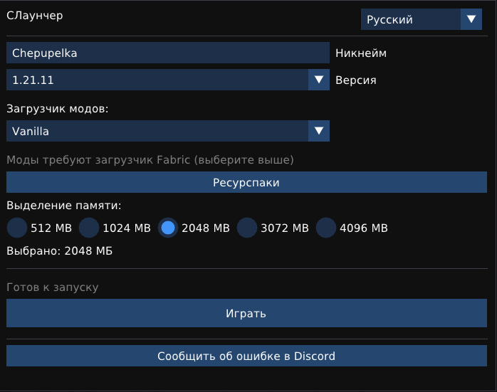
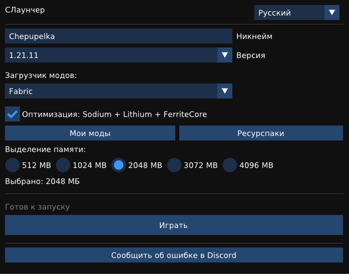

🇬🇧 [English](README.md) | 🇷🇺 Русский | 🇰🇿 [Қазақша](README_KZ.md)

# CLauncher

Лёгкий нативный лаунчер Minecraft для Linux и Windows, написанный на C++20 с интерфейсом на Dear ImGui и OpenGL. Спроектирован и написан одним разработчиком под старое железо: без рекламы, без телеметрии, без магазина, без обязательного аккаунта для офлайн-игры.

<p align="center">
  
</p>

Требуется **OpenGL 3.3 Core** или новее. Работает на Linux (Debian, Ubuntu, Mint, Kali, Fedora, Arch, openSUSE, Alpine и других дистрибутивах) и Windows 10/11. Размер бинарного файла — около трёх мегабайт, лаунчер в режиме простоя потребляет примерно 30–50 МБ ОЗУ (память для самой Minecraft задаётся отдельно в интерфейсе). Основная машина для разработки и тестов — настольный ПК 2012 года. Это практический ориентир для старого железа, а не гарантия работы на абсолютно любой конфигурации.

## ЧТО УМЕЕТ

* **Установка Vanilla Minecraft прямо из лаунчера.** Клиент, библиотеки, ассеты и нативные библиотеки скачиваются автоматически с официальных серверов Mojang.
* **Поддержка Fabric (Minecraft 1.14+).** Fabric ставится через официальный инсталлятор (лаунчер сам запускает его `.jar`), версия загрузчика берётся актуальной с серверов Fabric Meta. Для более старых версий опция Fabric скрыта.
* **Оптимизационные моды одной галочкой.** Fabric API, Sodium, Lithium и FerriteCore. Версии модов подбираются автоматически под выбранную версию Minecraft через API Modrinth.
* **Защита Log4Shell.** Лаунчер автоматически добавляет аргумент `-Dlog4j2.formatMsgNoLookups=true` для всех версий Minecraft ниже 1.18.1, защищая вас от критической уязвимости (CVE-2021-44228).
* **Умная параллельная загрузка.** Адаптивный пул потоков анализирует количество файлов и ядра процессора, чтобы качать ассеты до 3–4 раз быстрее. Расчёт скорости и ETA (оставшегося времени) стал точным и отзывчивым.
* **Отмена установки.** Вы можете безопасно закрыть окно лаунчера во время скачивания, и фоновый процесс установки корректно прервётся, не запуская игру.

<p align="center">
  
</p>

* **Свои моды.** Кнопка «Мои моды» открывает папку модов конкретной версии Fabric. Любой `.jar`-файл, положенный туда вручную, загрузится при запуске игры. У каждой версии Minecraft своя папка модов, поэтому моды разных версий не перемешиваются между собой.
* **Ресурспаки.** Кнопка «Ресурспаки» открывает общую папку ресурспаков. Положите туда zip-архив, а затем включите его в меню наборов ресурсов в самой игре.
* **Автоматическое управление Java.** Лаунчер больше не зависит от системных пакетных менеджеров (apt, dnf, pacman) и не требует `sudo`. Он всегда скачивает портативную JRE (8, 17, 21 под выбранную версию Minecraft) с серверов Adoptium в свою папку. Работает из коробки на любом дистрибутиве.
* **Проверка целостности.** Скачиваемые файлы игры, а также моды проверяются по SHA1 (через OpenSSL) там, где Mojang или Modrinth предоставляют контрольную сумму. Повреждённые и недокачанные файлы обнаруживаются и перекачиваются автоматически.
* **Защита от двойного запуска.** Если случайно запустить CLauncher дважды, второе окно сразу закрывается — два процесса не качают ассеты в одну и ту же папку.
* **Сохранение сессии.** Никнейм, выбранная версия Minecraft, загрузчик модов, память и язык сохраняются между запусками.
* **Корректная работа с окном.** При нажатии Play окно лаунчера скрывается, пока идёт игра, и автоматически возвращается после выхода из Minecraft.
* **Отзывчивый интерфейс.** Вся установка идёт в фоновом потоке, окно не зависает. Вы можете переключать язык интерфейса прямо на лету, даже во время загрузки.
* **Два языка интерфейса.** Английский и русский, переключение на лету, выбор сохраняется.
* **Логирование в файл.** Всё, что выводит лаунчер, пишется в `clauncher.log` в папке `~/.clauncher/logs/` (или `%APPDATA%\CLauncher\logs\` на Windows).
* **Безопасный запуск.** Игра запускается через `execv` на Linux и `CreateProcessW` на Windows, без привлечения командной оболочки. Длинный classpath передаётся через argfile, поэтому ни его длина, ни спецсимволы в никнейме не сломают запуск.

## ПОДДЕРЖИВАЕМЫЕ ВЕРСИИ

* **Vanilla и Fabric:** все релизы ветки 1.x из манифеста Mojang, вплоть до линейки 1.21.x (Fabric — начиная с 1.14.x).
* **Линейка 26.x** временно не поддерживается в 1.0.2. Она требует Java 25 и новый инструментарий моддинга, которые ещё стабилизируются. **Поддержка 26.x планируется в версии 1.0.4 (см. [Планы](#планы)).**

**Требования к системе:** любой современный дистрибутив Linux с glibc 2.35+ и **OpenGL 3.3 Core**, либо Windows 10 и 11. Готовый AppImage требует glibc 2.35 или новее; на старых системах собирайте из исходников.

## СКАЧАТЬ

Готовые сборки лежат на [странице Releases](https://github.com/chepupel123/CLauncher/releases):

* `CLauncher-Linux.zip` — Linux x86_64. Внутри — самодостаточный `CLauncher-x86_64.AppImage`: всё в комплекте, ничего доустанавливать не нужно (требует glibc 2.35+; распакуйте, сделайте исполняемым, запустите).
* `CLauncher-Windows-x64.zip` — Windows 10/11 x64 (бета, ещё не полностью протестирована на реальной Windows-машине). Внутри — `CLauncher.exe` вместе с необходимыми DLL (GLFW/curl/OpenSSL) и `cacert.pem`; распакуйте и запустите `.exe`.

Если хотите собрать из исходников — инструкция ниже.

## БЫСТРЫЙ СТАРТ НА LINUX

Сначала установите зависимости. В терминале выполните:

**Debian / Ubuntu / Mint / Kali / Pop!_OS:**
```bash
sudo apt-get update
sudo apt-get install -y build-essential cmake git pkg-config unzip \
  libglfw3-dev libgl1-mesa-dev libcurl4-openssl-dev libssl-dev \
  nlohmann-json3-dev libx11-dev libxrandr-dev libxinerama-dev \
  libxcursor-dev fonts-dejavu-core
```

Fedora / RHEL / CentOS Stream:

```bash
sudo dnf install -y gcc-c++ cmake git pkg-config unzip \
  glfw-devel mesa-libGL-devel libcurl-devel openssl-devel \
  nlohmann-json-devel libX11-devel libXrandr-devel \
  libXinerama-devel libXcursor-devel dejavu-sans-fonts
```

Arch / Manjaro / EndeavourOS:

```bash
sudo pacman -S --needed base-devel cmake git pkg-config unzip \
  glfw mesa curl openssl nlohmann-json libx11 libxrandr \
  libxinerama libxcursor ttf-dejavu
```

Затем скачайте проект и соберите:

```bash
git clone https://github.com/chepupel123/CLauncher.git
cd CLauncher
rm -rf build
mkdir build
cd build
cmake ..
make -j$(nproc)
```

Запустите:

```bash
./CLauncher
```

БЫСТРЫЙ СТАРТ НА WINDOWS

Понадобится MSYS2. Скачайте установщик с сайта msys2.org и установите в C:\msys64. Откройте терминал MSYS2 UCRT64 (не MINGW64!) и выполните:

```bash
pacman -Syu
pacman -S --needed mingw-w64-ucrt-x86_64-gcc mingw-w64-ucrt-x86_64-cmake \
  mingw-w64-ucrt-x86_64-ninja mingw-w64-ucrt-x86_64-curl \
  mingw-w64-ucrt-x86_64-openssl mingw-w64-ucrt-x86_64-glfw \
  mingw-w64-ucrt-x86_64-nlohmann-json make
```

Затем перейдите в папку проекта и соберите:

```bash
mkdir build
cd build
cmake .. -G Ninja -DCMAKE_BUILD_TYPE=Release
ninja
```

Появится файл CLauncher.exe. В релизном zip уже лежат все необходимые DLL и cacert.pem (хранилище TLS-сертификатов).

КАК ЭТО РАБОТАЕТ ВНУТРИ

При нажатии Play лаунчер выполняет цепочку:

1. MinecraftInstaller синхронизируется с манифестом Mojang и скачивает всё недостающее: клиент, библиотеки, тысячи файлов ассетов и нативные компоненты. Адаптивный пул загрузки оптимизирует скорость под ваше железо.
2. Fabric (опционально). Если выбрано, официальный инсталлятор Fabric запускается в безопасной staging-папке, после чего из Modrinth подтягиваются Fabric API, Sodium, Lithium и FerriteCore под вашу версию игры.
3. JavaManager скачивает и распаковывает нужную портативную JRE (Java 8, 17 или 21 — в зависимости от версии игры) с Adoptium, если подходящая версия ещё не закеширована в папке лаунчера.
4. JavaLauncher запускает игру через execv (Linux) или CreateProcessW (Windows). Между лаунчером и игрой нет оболочки, а длинный classpath передаётся через argfile.
5. Пока игра запущена, окно лаунчера скрыто. Когда вы выходите из Minecraft, окно возвращается автоматически и готово к следующему запуску.

ГДЕ ЧТО ЛЕЖИТ

На Linux:

· Игра (миры, моды, конфиги): ~/.minecraft/
· Настройки лаунчера, кеш, JRE: ~/.clauncher/ (в частности ~/.clauncher/runtime/ и ~/.clauncher/launcher_settings.json)
· Лог лаунчера: ~/.clauncher/logs/clauncher.log

На Windows:

· Игра: %USERPROFILE%\.minecraft\
· Настройки лаунчера, кеш, JRE: %APPDATA%\CLauncher\
· Лог лаунчера: %APPDATA%\CLauncher\logs\clauncher.log

ИДЕНТИФИКАЦИЯ ОФЛАЙН-ИГРОКА

Лаунчер генерирует детерминированный офлайн-UUID из никнейма по стандартной схеме Minecraft OfflinePlayer (UUID на основе MD5-хеша имени, версия 3). Он стабилен между запусками, поэтому прогресс в мирах сохраняется корректно.

ИЗВЕСТНЫЕ ОГРАНИЧЕНИЯ

· Windows-исполняемый файл не подписан, поэтому SmartScreen или антивирус могут показать предупреждение при первом запуске («Подробнее» → «Выполнить в любом случае»).
· Первая установка небыстрая: тысячи файлов ассетов. Последующие запуски гораздо быстрее, потому что всё кешируется и проверяется по SHA1.
· Кириллица в никнейме не принимается намеренно: никнейм попадает на серверы и в файлы миров, где безопасен только ограниченный набор символов.

ЕСЛИ ЧТО-ТО НЕ РАБОТАЕТ

· Ошибка GLFW init failed: GLFW не установлен, или вы запускаете лаунчер вне графической сессии.
· Вопросительные знаки вместо текста: не найден шрифт с поддержкой кириллицы. Установите fonts-dejavu-core (Debian/Ubuntu), dejavu-sans-fonts (Fedora), ttf-dejavu (Arch).
· Игра вылетает сразу после старта: скорее всего, в папке лежит мод под другую версию Minecraft. Удалите его из mods.
· Загрузка остановилась на середине: нажмите Play снова — уже скачанные файлы сохранятся и проверятся по SHA1, докачаются только недостающие.

## ПЛАНЫ

· v1.0.3 — Система инстансов: изолированные инстансы под разные модпаки и версии, чтобы переключаться между ними без смешивания модов.
· v1.0.4 — Forge и поддержка 26.x: добавление загрузчика Forge и возвращение линейки Minecraft 26.x (требует Java 25).
· v1.0.5 — Интеграция Modrinth: встроенный браузер с API Modrinth. Поиск и установка модов, ресурспаков и шейдеров в один клик.

ССЫЛКИ

· GitHub-репозиторий: https://github.com/chepupel123/CLauncher
· Документация (EN): README.md
· Документация (KZ): README_KZ.md
· Discord: https://discord.gg/kazYTTErkT
